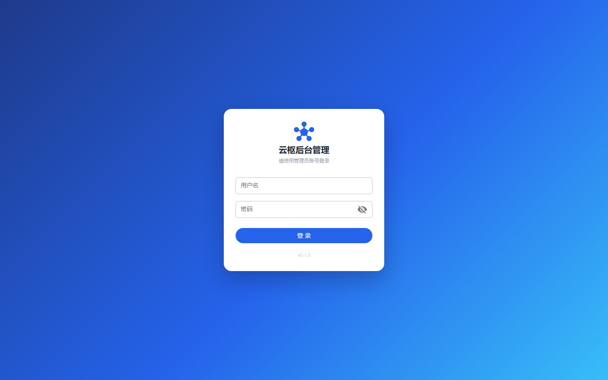
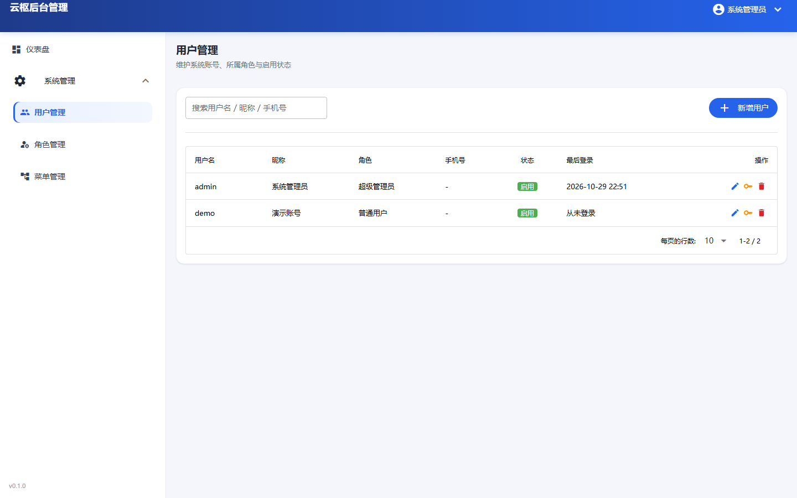
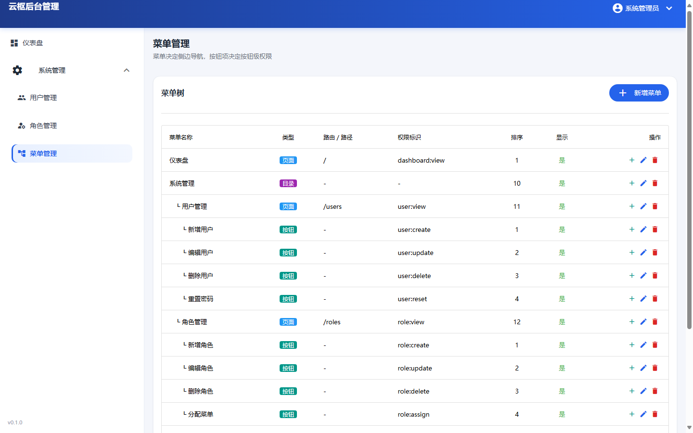
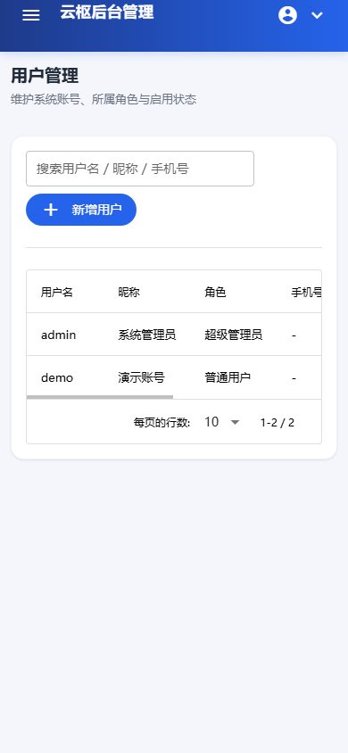
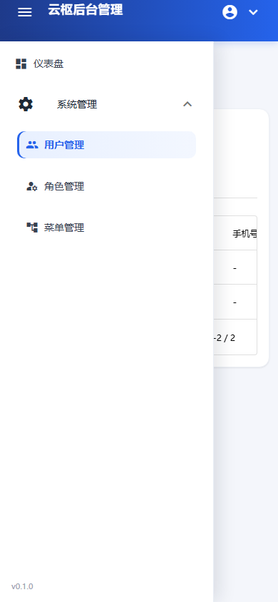

# 云枢后台管理（NiceGUI 版骨架）

一套**可直接运行、可打包成 exe、无需独立服务器和数据库**的后台管理系统骨架。
电脑端和手机端共用同一套响应式界面，数据存在本地 SQLite 文件里。

> 已实测：9 个无头 UI 测试全部通过；PyInstaller 打包出的 exe 双击即用；
> 桌面端 1440×900 / 手机端 390×844 均已截图验收。



## 已实现

- 登录 / 退出（NiceGUI 加密 Cookie 会话，密码 bcrypt 加盐存储）
- **用户管理**：新增、编辑、删除、启用禁用、分配角色、重置密码、搜索
- **角色管理**：新增、编辑、删除、按菜单/按钮粒度分配权限
- **菜单管理**：目录 / 页面 / 按钮三级树，菜单即权限来源（动态驱动左侧导航）
- **按钮级权限**：无权限的按钮不渲染，后端回调也会再次校验
- 仪表盘：账号、角色、菜单统计 + 最近登录
- 中间件拦截：未登录访问任何页面自动跳转登录页，登录后回到原页面
- 响应式布局：≥1024px 为侧边栏，手机端为抽屉式导航（顶栏汉堡按钮）
- 修改密码、SQLite WAL、备份函数、日志落盘

| 用户管理 | 菜单管理 |
|---|---|
|  |  |

| 手机端 | 手机端抽屉 |
|---|---|
|  |  |

## 环境

- Windows 10/11
- Python 3.10+（本项目用 3.12.8 验证，装在 `%LOCALAPPDATA%\Programs\Python\Python312`）
- 依赖：`nicegui 3.18` / `SQLAlchemy 2.1` / `bcrypt 5.0`

## 快速开始

双击 `run_dev.bat`，或：

```bat
cd nicegui-admin
.venv\Scripts\activate
python main.py
```

浏览器自动打开 <http://127.0.0.1:8080>。首次启动会自动建库、建表、写入默认数据：

| 账号 | 密码 | 说明 |
|---|---|---|
| admin | admin123 | 超级管理员，拥有全部权限 |
| demo | demo123 | 普通用户，只有仪表盘 + 用户管理只读 |

> 上线前务必修改 admin 密码（右上角头像 → 修改密码）。

## 在 Trae 里打开

1. Trae → **文件 → 打开文件夹** → 选 `nicegui-admin` 这个目录（不用新建工程、不用克隆）。
2. 首次打开会提示选解释器，选 `.venv\Scripts\python.exe`；没提示的话按
   `Ctrl+Shift+P` → `Python: Select Interpreter` → 选这一项。
3. 按 **`Ctrl+Shift+B`**（或在命令面板执行 `Tasks: Run Task`）选「启动服务并打开预览」。
   任务会以无窗口模式在后台启动服务（不弹系统浏览器），终端里会打印本机地址
   （默认 8080，被占用时自动 +1，以打印出来的为准）。
4. **按住 `Ctrl` 点击**终端里的 `http://127.0.0.1:8080` 链接，就会在 **Trae 内置浏览器**中
   打开后台。工作区已把 `trae.terminal.autoOpenLocalLink.mode` 设为 `integrated`（Ctrl+单击直达内置浏览器）；
   若本机 Trae 版本不认这个工作区配置，第一次 Ctrl+单击会弹菜单，选「在内置浏览器中打开」即可，
   也可以用 `Ctrl+Shift+P` → `Simple Browser: Show` → 粘贴地址。
5. `.trae/rules/project_rules.md` 里的项目规则会自动生效，AI 改代码时会遵守项目约定。

仓库里已经预置好 `.vscode/settings.json`（解释器、排除 `.venv`/`dist`/`data` 的搜索索引）、
`.vscode/launch.json`（调试配置）、`.vscode/tasks.json`（启动 / 预览 / 测试 / 打包任务）。

## 改完代码怎么验证

```bat
.venv\Scripts\python.exe -m pytest
```

`tests/test_smoke.py` 用 NiceGUI 官方的 `User` 夹具做无头测试，覆盖：登录页渲染、
错误密码提示、登录跳转、三个管理页数据、新增用户闭环、普通用户看不到新增按钮、
未登录跳转登录页。**在 Trae 里让 AI 改完代码，先跑一遍这个再交付。**

截图验收（可选，用系统自带 Edge 无头模式）：

```bat
.venv\Scripts\python.exe tools\visual_check.py
```

## 手机端访问

程序默认监听 `0.0.0.0`，启动时控制台会打印局域网地址：

```
本机访问: http://127.0.0.1:8080
手机/局域网访问: http://192.168.1.20:8080
```

手机连同一个 WiFi，浏览器输入该地址即可。若打不开，用管理员 PowerShell 放行端口：

```powershell
netsh advfirewall firewall add rule name="云枢后台" dir=in action=allow protocol=TCP localport=8080
```

## 目录结构

```
nicegui-admin/
├─ main.py                 # 入口：初始化、注册页面、启动
├─ app/
│  ├─ config.py            # 路径/端口/密钥（打包后数据写到 exe 同级 data/）
│  ├─ database.py          # SQLite 引擎（WAL）、会话、备份
│  ├─ models.py            # User / Role / Menu + 两张关联表
│  ├─ auth.py              # 密码、登录态、权限判定、登录拦截中间件
│  ├─ seed.py              # 首次启动写入默认角色/菜单/账号
│  ├─ theme.py             # 全局 CSS（含移动端断点）+ Quasar 主题色
│  ├─ layout.py            # 顶栏 + 侧边栏 + 权限校验 shell()
│  └─ pages/               # login / dashboard / users / roles / menus
├─ tests/                  # 无头 UI 测试
├─ tools/visual_check.py   # Edge 无头截图验收
├─ data/                   # 运行时生成：app.db、secret.key、logs/
├─ dist/云枢后台管理/       # 已打包好的 exe（885 个文件，67 MB）
├─ run_dev.bat
└─ build_exe.bat
```

## 新增一个业务模块（例如“订单管理”）

1. **建模型**：`app/models.py` 加 `Order` 表。
2. **加菜单**：登录后「菜单管理」→ 新增菜单，路径 `/orders`，权限标识 `order:view`；
   再给它加子按钮 `order:create` / `order:update` / `order:delete`。
3. **配权限**：「角色管理」→ 分配权限，勾上刚建的菜单和按钮。
4. **写页面**：复制 `app/pages/users.py` 改业务字段，`@ui.page('/orders')`。
5. **注册**：`main.py` 的 `from app.pages import ...` 里加上 `orders`。

菜单是数据库驱动的，**改导航和权限不用改代码**，这是这套骨架最值钱的地方。

## 打包成 exe

双击 `build_exe.bat`，产物在 `dist\云枢后台管理\`，整个文件夹发给客户即可。
客户机器**不需要**装 Python、不需要装数据库。

实测命令（也是 `build_exe.bat` 里的）：

```bat
python -m PyInstaller --noconfirm --clean --onedir --windowed ^
  --name "云枢后台管理" ^
  --collect-all nicegui ^
  --collect-submodules uvicorn ^
  --hidden-import sqlalchemy.dialects.sqlite ^
  main.py
```

### 打包踩过的两个坑（已在代码里解决）

1. **`--windowed` 下 `sys.stdout` / `sys.stderr` 是 `None`**
   uvicorn 启动时写日志会直接崩，表现是「进程还在，但端口永远不监听」。
   `main.py` 里的 `ensure_std_streams()` 在启动前把两个流重定向到
   `data/logs/stdout.log`，专门解决这个问题。
2. **数据库不能放 `sys._MEIPASS`**
   onefile 模式下那是每次重启都变的临时目录。本项目 `config.py` 统一把
   数据写到 **exe 同级的 `data/`**，升级程序时保留该目录即可不丢数据。

其它建议：用 `--onedir` 而不是 `--onefile`（启动快、杀软误报少）；
正式交付若被杀软拦，买代码签名证书。

## 配置项（环境变量）

| 变量 | 默认 | 说明 |
|---|---|---|
| `APP_PORT` | 8080 | 端口被占用会自动 +1 探测 |
| `APP_HOST` | 0.0.0.0 | 只想本机用可设 127.0.0.1 |
| `APP_DATA_DIR` | 程序目录/data | 数据目录，可指到 D 盘 |
| `APP_HEADLESS` | 0 | 设 1 则不自动开浏览器 |
| `APP_NATIVE` | 0 | 设 1 用桌面窗口（pywebview）打开 |
| `APP_SECRET` | 自动生成 | 会话密钥，改动会让所有人重新登录 |

## 已知取舍

- 手机端宽表格是**横向滑动**查看，不是卡片式重排。要更适合手机的体验，
  可以在 `users.py` 里按 `ui.context.client` 做两套渲染，或给表格列加
  `classes` 在小屏隐藏次要列。
- SQLite 适合 5 人以内并发写；20 人以上建议换 PostgreSQL（仍需打包内置）。
- 没有做操作日志表，`app/models.py` 里加一张 `OperationLog` 即可。

## 备份

`app/database.py` 里已有 `backup_to(path)`，基于 `VACUUM INTO`，运行中也能拿到一致快照。
建议在「系统设置」页加个按钮调用它，导出到 U 盘或网盘目录。
